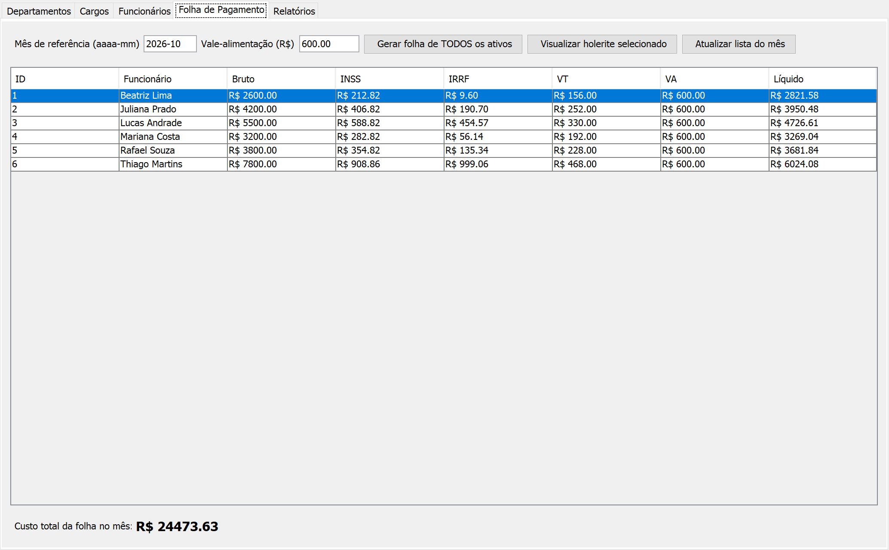
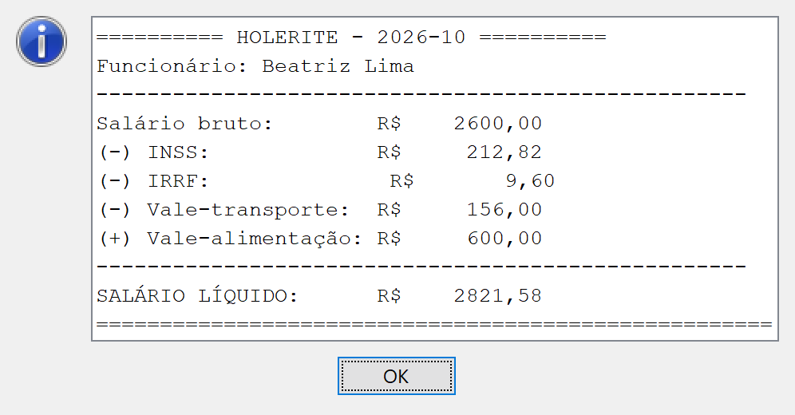
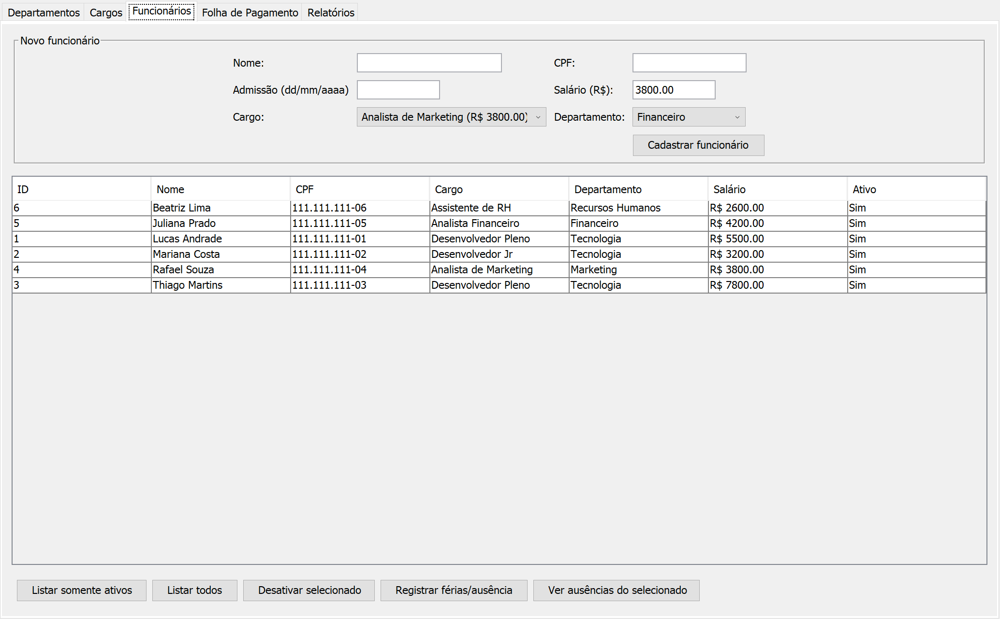

# RH Folha

Sistema desktop de RH que calcula a folha de pagamento sozinho: **INSS progressivo faixa a faixa, IRRF sobre a base depois do INSS e desconto de vale-transporte limitado a 6%**. Feito em Java com Swing, MySQL e JDBC.




| Holerite | Funcionários |
| :---: | :---: |
|  |  |

*Valores calculados pelo próprio sistema; nomes e CPFs de exemplo.*

## O que este projeto mostra

- **Regra de negócio de verdade:** o INSS é calculado por faixas, como na tabela oficial, e o IRRF usa a base já descontada do INSS. A lógica fica isolada em `util/CalculadoraFolha.java` (`calcularInss`, `calcularIrrf`, `calcularDescontoVt`).
- **Dinheiro sem erro de arredondamento:** todas as contas usam `BigDecimal`.
- **Integridade no banco:** uma restrição `UNIQUE (funcionario_id, mes_referencia)` impede gerar duas folhas para o mesmo funcionário no mesmo mês.
- **Organização em camadas:** `model` (entidades), `dao` (acesso ao banco com `PreparedStatement`), `ui` (telas Swing) e `util`.

## Contexto

O fechamento da folha é uma das tarefas mais sujeitas a erro num departamento pessoal: o INSS não é uma porcentagem única, e sim uma soma de faixas; o IRRF depende do valor que sobra depois do INSS; e qualquer arredondamento errado vira diferença no holerite. Em vez de planilhas soltas, o RH Folha guarda funcionários, cargos e departamentos num banco relacional e gera a folha do mês de uma vez, com os mesmos critérios para todos.

## Funcionalidades

- **Departamentos e cargos**, com salário base por cargo.
- **Funcionários**, com admissão, desligamento (sem apagar o histórico), cargo, departamento e salário.
- **Ausências:** férias, atestados e faltas por período.
- **Folha de pagamento:** escolhe o mês e o valor do vale-alimentação e gera a folha de todos os ativos, com bruto, INSS, IRRF, VT, VA e líquido, mais o custo total do mês.
- **Holerite** de cada funcionário.
- **Relatórios** de custo por departamento.

## Como o cálculo funciona

| Etapa | Regra |
| :--- | :--- |
| INSS | O salário é dividido nas faixas da tabela; cada pedaço recebe a sua alíquota e as parcelas são somadas. |
| IRRF | Calculado sobre o salário bruto menos o INSS, com a alíquota e a dedução da faixa. |
| Vale-transporte | 6% do salário bruto. |
| Vale-alimentação | Valor informado na geração da folha, somado ao líquido. |
| Líquido | Bruto − INSS − IRRF − VT + VA. |

## Estrutura

```text
sql/schema.sql            # cria o banco rh_folha, as tabelas, departamentos e cargos de exemplo
src/
├── Main.java
├── config.properties.example
├── model/                # Funcionario, Cargo, Departamento, FolhaPagamento, Ausencia, TipoAusencia
├── dao/                  # um DAO por entidade + RelatorioDAO
├── ui/                   # TelaPrincipal e as abas: Departamentos, Cargos, Funcionários, Folha, Relatórios
└── util/
    ├── ConexaoFactory.java   # lê o config.properties e abre a conexão
    └── CalculadoraFolha.java # INSS, IRRF e VT
```

| Tabela | Conteúdo |
| :--- | :--- |
| `departamento` | Nome (único). |
| `cargo` | Nome e salário base. |
| `funcionario` | Nome, CPF (único), admissão, cargo, departamento, salário e se está ativo. |
| `folha_pagamento` | Mês, bruto, INSS, IRRF, VT, VA, líquido e data de geração (uma por funcionário por mês). |
| `ausencia` | Tipo (férias, atestado, falta), período e observação. |

## Como rodar

Pré-requisitos: JDK 17+, MySQL 8 e o driver [MySQL Connector/J](https://dev.mysql.com/downloads/connector/j/) (`.jar`).

1. Rode `sql/schema.sql` no MySQL (Workbench, DBeaver ou terminal).
2. Copie `src/config.properties.example` para `src/config.properties` e preencha usuário e senha do seu MySQL.
3. Rode pela IDE (adicione o `.jar` do Connector/J às bibliotecas e execute `Main.java`) ou pelo terminal, com o `.jar` numa pasta `lib/`:

```bash
cd src
javac -d ../out -cp ".:../lib/mysql-connector-j.jar" $(find . -name "*.java")
cp config.properties ../out/
cd ../out
java -cp ".:../lib/mysql-connector-j.jar" Main
```

No Windows, troque `:` por `;` no `-cp`.

| Erro | Solução |
| :--- | :--- |
| `Não foi possível carregar config.properties` | O arquivo não foi copiado para a pasta `out`. |
| `Access denied for user` | Usuário ou senha errados no `config.properties`. |
| `Public Key Retrieval is not allowed` | Acrescente `&allowPublicKeyRetrieval=true` na `db.url`. |
| `Communications link failure` | O MySQL não está ligado. |

## Próximos passos

- [ ] Testes automatizados (JUnit) para `CalculadoraFolha`
- [ ] 13º salário e férias proporcionais
- [ ] Holerite em PDF
- [ ] Login com perfis (gestor de RH e funcionário)
